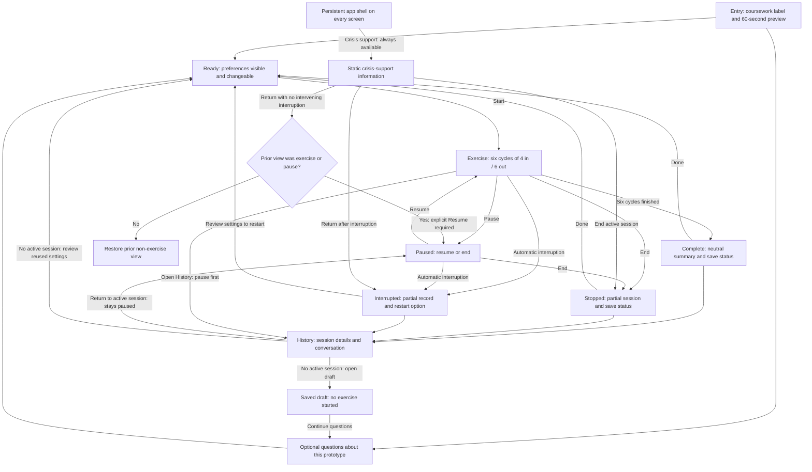

# Pause: Part 3.1 design

Historical baseline: proposed October 8 and revised October 13, 2026. Those design-stage plans were not test results. Part 3.2 implementation/evidence followed on October 19–21; the full supplied table is now mapped in [research-findings.md](research-findings.md). Dated implementation sections below supersede the original proposals. No clinical effect has been tested.

## Purpose and scope

Pause will let a reviewer complete the assignment's 4–6 paced-breathing sequence with little reading or typing. The primary action starts a 60-second exercise. An optional conversational panel answers questions about the interface using approved material. Saved sessions and explicit preferences demonstrate persistence and personalization.

The fictional walkthrough uses Alex, a student preparing for an imagined presentation. This is a test character, not a study participant or a person seeking support. No onboarding asks for a diagnosis, distress rating, name, or personal history.

Only paced breathing is in the initial scope. It has a defined rhythm, permits a measurable duration, and can run without typed responses. Grounding remains a possible later skill; implementing four skills would add navigation and verification work before the basic experience is established. The reframe option is deferred because it demands several written judgments. This choice is about implementation and interaction effort, not evidence that breathing is clinically superior.

## Main experience



The persistent shell exists at entry, optional questions, ready, exercise, pause, completion, stopped/interrupted views, history, and every error view. Opening support during an exercise pauses it through an explicit user action. Return restores Paused when support was opened over the exercise or pause screen; otherwise it restores the prior view. If that exercise was interrupted while support was open, Return shows Interrupted instead. Support includes immediate End whenever an active session is paused behind it. No model response triggers a navigation transition.

Text equivalent: entry → ready → exercise → completion → optional history or Done → ready. Questions are optional before starting. Pause, end, and crisis support remain available during the exercise. Opening History while running pauses first; History then displays a paused-session banner with Return to exercise and End. Returning never resumes automatically. Reusing settings for a new session is available only after the active session ends. History can populate Ready, but a new exercise requires Start. Never-started conversations remain drafts; an interrupted exercise offers a new start through Ready, not Resume.

## Screen sketches

These are layout sketches, not screenshots or functional controls. Bracketed text denotes a proposed control. The crisis link is part of the common shell, not a chat message.

```text
ENTRY / READY
Pause · Coursework prototype          [Crisis support]
Fictional testing only. Not therapy. Nobody monitors this app.

4–6 paced breathing · 60 seconds
In for 4 counts. Out for 6. Repeat 6 times.

[Start 60-second exercise]
[Questions about this prototype]      [History]

Pacing cue: [Animated circle | Text only]
[ ] Remember this choice on this device
Local saving is attempted for fictional sessions/questions.
Check save status.                    [Data controls]
```

```text
EXERCISE
Pause · Coursework prototype          [Crisis support]

                     Inhale
                        3
              (expanding pacing circle)

                 Cycle 2 of 6

                   [Pause]  [End]
Pacing cue: [Animated circle | Text only]
Changes here apply to this session only.
```

```text
PAUSED / COMPLETE
Pause · Coursework prototype          [Crisis support]

Paused · cycle 2 of 6                 Exercise complete
[Resume] [End]                       6 cycles · 60 seconds intended
Pacing cue: [Animated | Text only]
                                     Saved on this device / Not saved
                                     [View session] [Done]
```

```text
SUPPORT / INTERRUPTED
Pause · Coursework prototype          [Crisis support]

Bundled support information           Exercise interrupted
and prototype limits                  Available partial record · save status
[Return] [End active session]          [Review settings to restart] [History]
End appears when a session is paused behind this panel.
```

```text
HISTORY
Pause · Coursework prototype          [Crisis support]

Oct 8 · 4–6 breathing · Completed · measured duration
Oct 8 · 4–6 breathing · Stopped · partial duration
[Open session]                        [Delete session]

Session detail: status, timing, initial/final cue, optional Q&A
Response source: Mock / Live model / Fixed fallback
[Use final cue setting]               [Back]
If a session is paused: [Return to exercise] [End]
```

Keep the primary exercise screen to one instruction, one count, and one cycle indicator. Use the circle's expansion for inhale and contraction for exhale, with visible text carrying the same information. Honor the operating system's reduced-motion setting by default; the visible cue selector on Ready, Exercise, and Paused lets a user choose text-only pacing. Changing cues during a session preserves its exact phase, count, and fractional progress and does not save a preference. History records the initial cue, each explicit change, and the final or last observed cue. Reuse copies that last cue into Ready for review. Text-only mode retains the timed phase and count. Announce phase changes for screen readers, not animation frames. Keyboard operation, focus visibility, zoom, and actual screen-reader pacing still need browser checks.

Speech is excluded from this version. This avoids adding microphone permissions, recognition errors, audio timing, and a second verification path to the initial scope.

## Timing and interruption

At one second per count, one cycle is 4 + 6 = 10 seconds; six cycles total 60 seconds. The first rendered “Inhale” is the timing start. At 60 seconds of uninterrupted active time, the last exhale ends and the completion view is rendered. There are no planned instruction screens, model waits, save waits, or required user responses inside that interval. Saving occurs asynchronously and never delays the final step.

This is a calculated design target, not a measured result. Later tests must record actual first/final render timestamps, with a target of approximately 60–62 seconds and the assignment's maximum of 90 seconds. If application delays exceed the budget, record a failure; do not hide them by reporting only the intended schedule.

Entry and setup are estimated at 10–20 seconds for a reader who skips optional questions; this estimate is unmeasured. Optional conversation time is separate and user-dependent. A model timeout is proposed at eight seconds, but Start is available throughout; late responses cannot interrupt an exercise.

The controller uses one monotonic source, `performance.now()`, for in-page elapsed timing. UTC clock timestamps are metadata, not a pacing clock or duration calculation. Pause freezes exact phase progress, including the fraction of the current one-second count; Resume continues the remaining fraction. End is immediate, including from support or a History paused-session banner, has no confirmation dialog, and records a stopped session. The completion view has no forced-dismissal timer or automatic restart. Done returns to Ready without starting another session. See the [state and transition contract](architecture.md#exercise-state-and-transition-contract).

Record wall time, explicit user-pause intervals, and time spent in the support view separately. The assignment-comparable duration excludes only user-chosen pauses and support access. A hidden tab, reload, process suspension, or long scheduling gap is an interruption, not an excludable user pause: stop pacing, mark the run interrupted, and require an explicit restart from Ready. Do not claim that an interrupted run met the duration requirement. Background handling and the scheduling-gap threshold must be verified in the actual browser.

## Personalization and user control

| Choice | Benefit | Cost and control |
| --- | --- | --- |
| One skill, one prominent Start action | Low reading and decision effort | Less skill choice; scope is explicitly shown before starting. |
| Optional explanation panel | Supports questions without forcing conversation | Model relevance can vary; exercise entry stays independent. |
| Remember cue choice only after an explicit selection | Avoids repeated setup | Adds a small preference control; default is session-only. Reset is available. |
| Show remembered cue setting on Ready | Makes adaptation visible | Uses some screen space; change remains one action away. |
| Save local fictional sessions and Q&A by default, with an upfront notice | Demonstrates persistence and useful history | Requires deletion controls and an explanation of local storage. No real personal data should be entered. |
| “Use final cue setting” in history | Reuses the final or last observed cue shown in the record | Does not infer that a skill helped, save a preference, or automatically start it. |

The application knows selected settings, submitted fictional text, and interaction/session records. It does not know distress level, diagnosis, whether someone followed the pacing, or whether the exercise helped. It does not adapt duration from typing speed, sentiment, pause frequency, or past completion. Saved history is an activity record, not a clinical progress score. No streaks, improvement claims, or pressure to finish are shown.

## Model contribution

The model interprets natural-language questions such as “Does this keep what I type?” or “Can I do this without the moving circle?” and selects relevant answers from a small approved catalog. Context contains the skill description, interface/data policies, explicitly selected cue preference, and the current session's recent conversation. This is a small grounded retrieval task; a vector database is unnecessary for a handful of entries.

The rendered reply consists only of validated catalog text. This permits useful language understanding while keeping therapeutic content and application controls out of model output. An invalid response, timeout, or unavailable provider produces fixed explanatory copy. A valid but irrelevant catalog selection remains possible and must be evaluated with live cases. See the [model contract](architecture.md#model-contract) for examples and validation boundaries.

A follow-up review of the optional Kaggle resource provides a concrete comparison for this intent-to-response structure. It also reinforces the decision to keep personal-context questions out of required entry. The [source notes](sources.md#optional-conversational-dataset) distinguish the inspected sample from unreviewed records. Dataset replies are not imported into the application's approved catalog.

The [dataset design notes](dataset-design-notes.md) show the concrete adaptation with authored input variations for motion, storage, and controls. They document actual design use of the supplied resource, not model training or clinical validation.

## Crisis access and crisis-related input

Every screen includes a visibly labeled **Crisis support** control. It opens static bundled information before any network request. The panel explains the prototype's limits, identifies the U.S. 988 call/text and official chat options, and links to a country-based directory for other locations. The U.S. label is explicit; location is never inferred. External calls/chat still depend on the device, network, and third-party service.

For an explicit matched crisis phrase in a fictional question, show a fixed boundary message and the same support panel; do not call the model for that input. A small documented phrase list is a cue for this branch, not a distress detector. Matching may miss paraphrases and non-English text and may flag quotations or negations. A false match must not lock the user out: let them dismiss the panel or leave the prototype. A missed match cannot remove the permanent support route. No alert is sent, no contact is made automatically, and no human monitoring is implied.

If the API fails, the local support panel, pacing, and exit controls remain usable. A visible message distinguishes an unsaved session from a saved one. The static information can remain readable after the app has loaded without a working API; this is not a claim that the entire app or external services work offline.

## Research connections and tradeoffs

The brief describes a study involving 15 patients, 13 clinicians, 15 prototype evaluations, and 150 coded participant–task combinations. These describe the evidence source, not an efficacy trial. The full R1–R4 / D1–D6 table was not included in the original design-stage source. It arrived October 21 and is now mapped in [research-findings.md](research-findings.md); the original limited mapping below is retained as design history. The supplied Kaggle link is a separate conversation resource.

| Available evidence | Design decision and reasoning | Alternative / tradeoff | Planned verification |
| --- | --- | --- | --- |
| R1: attention was lost beyond 90–100 seconds; assignment limit is 90 seconds | Use six 10-second cycles and no network dependency during pacing. | A 90-second sequence leaves little margin for delays; 60 seconds uses the lower end of the specified range. | Record actual render-to-render duration and app delays. |
| D1 caveat: simplicity is not a reliable distress detector | Use a consistently simple exercise view and explicit settings. | Automatic simplification might reduce effort but relies on unverified inference. | Different fictional wording cannot silently change duration or cue preference. |
| Brief narrative: balance personalization, effort, and control; exact table labels pending | Remember an optional cue choice, display it, allow override. | Required onboarding adds effort; hidden adaptation removes control. | Saved preference round trip, override, reset, and history reuse. |
| Brief narrative: model tone alone does not ensure sequence, exits, state, or crisis access | Put those responsibilities in client/server code and static content. | Chat-led pacing permits variable delays and uncontrolled wording. | Failure injection while checking pacing and global controls. |
| Brief narrative: avoid unnecessary reading and typing | No required text entry or rating; optional questions remain off the exercise screen. | Less free-form dialogue and less subjective feedback. | Complete a fictional walkthrough without typing. |

These original narrative rows were not substitute definitions for R2–R4 or D2–D6. The completed October 21 mapping now uses the actual instructor table.

## Decisions still to resolve

1. Resolved October 21: table supplied and mapped; one-skill scope retained, D5/R4 personalization compromise documented, and R3 motivates an unsaved-exit option.
2. Verify text-only and animated pacing, focus behavior, and phase announcements in the target browser; choose and record that browser/version.
3. Select a live-model provider/model permitted by the course and verify the catalog-selection quality against mocks. Record the exact model identifier when used.
4. Decide the maximum tolerated browser scheduling gap based on an actual timing experiment; until then, interrupted timing is a documented limitation.
5. Supply the earlier coursework repositories if code reuse is desired; name exact reused files and modifications after inspection.
6. Supply the repository URL and final submission commit, then check that the instructor can access every report link.

## Part 3.2 implementation notes — October 19, 2026

The design above remains the Part 1 baseline. The implemented interface uses a Ready view with a direct Start action, optional collapsed app questions, one active exercise, a neutral outcome summary, and saved History. A persistent sticky header holds Crisis support, including on narrow scrolling layouts. Support is a keyboard-focus-managed dialog with region-labeled bundled resources. Opening it or History pauses the exercise; Return does not resume. Leaving/hiding the page interrupts rather than silently finishing.

Motion uses the single exercise clock: the circle expands during four counts and contracts during six. Text only removes the moving shape. System reduced-motion chooses text by default; explicit choices can override it, and a later system request for reduced motion switches to text without resetting pace. Remember is a separate explicit write; an exercise cue change cannot write the preference. Reusing a recorded cue only copies it into Ready.

The first implementation review found that an exercise engine reused its elapsed-time fields across sessions. Start now resets its timing and pause fields; a regression test covers a second session. The first browser integration also called recovery with GET despite its POST API contract; browser/API logs led to the corrected method. Real model outputs led to simplifying the selector contract, as documented in the architecture implementation section. These are software findings, not clinical evidence.

Part 2 actual browser, model, database, and failure results are in [part2-verification.md](part2-verification.md). The full fifteen-scenario evaluation, repeated live variation study, final demonstration, and process screencast belong to Part 3 and are not claimed here.

## Sidebar assistant navigation — October 20, 2026

At the student's request, AI assistant is now a dedicated left-sidebar entry alongside Practice and Session history. It opens the existing question panel directly, preserving its conversation, mock/live selector, source labels, and support access. The Practice disclosure remains a second entry point to the same panel. Opening this view while running pauses the exercise; Return leaves it paused, and End remains immediate. New questions are disabled while the exercise remains active. Saved terminal sessions are retained in History; an unsaved terminal record must be saved before starting new questions. On narrow screens, all three navigation entries wrap into a three-column row to avoid horizontal overflow.


## Research and working-version revision — October 21, 2026

The newly supplied instructor table now supports an explicit [all-ten-findings mapping](research-findings.md). D1 is interpreted as simplification when the user starts the exercise, not inferred distress. D5's reduced repeated configuration is balanced with R4 by one optional, visible Remember action and reversible history reuse. The shell retains navigation/exit/support while the active main view carries one instruction; this is the documented D2/R4 compromise.

R3 exposed a usability problem in the prior implementation: End worked during save failure, but returning to Ready required a successful retry. The summary now offers Leave without saving, explains possible unsaved-data loss and retains any already saved History records. Actual browser checks returned to Ready without waiting, then saved a subsequent stopped session. The October 20 statement requiring save before a new conversation is superseded by this explicit discard option.

The original proposed cue/history model context is also superseded. Current v7 sends the current question, concise authored facts and three balanced authored topic examples, with no cue or saved messages. Local `qwen2.5:3b` replaced 1.5b after smaller-model and prompt-only revisions still selected irrelevant approved topics. The observed small v7 regression run matched motion, storage and controls, including the formerly wrong stop question; broader reliability remains unestablished. This change concerns app-question interpretation only and does not add therapeutic conversation or change pacing.


## October 27 visual and assistant refinement

The student requested breathing colors, a popup, visuals, FAQs and consideration of their ideation summary/references. Green inhale and blue exhale supplement words/counts; neutral amber indicates paused. A static SVG rhythm guide and six cycle markers add orientation without new skill steps. Start now appears before the decorative preview. Eleven optional FAQ topics and a collapsed reading shelf remain outside active practice. The user-opened assistant popup pauses an exercise, retains End/independent support, and requires explicit Resume on return. It shares the sidebar conversation.

The assistant remains educational rather than a therapist. A short sourced NIMH definition is general information; the provided book listing and DSM overview are explicitly not imported handbook content or diagnostic logic. The student's group-note concerns about privacy, questionnaire burden and click-based inference informed direct entry, explicit cue preferences and a check-in FAQ. No questionnaire or click-based stress model was added. This balances the supplied D3/D5/R4 direction without inventing access to the original papers. See [actual changes, sources and observations](ui-refinement-oct27.md).
