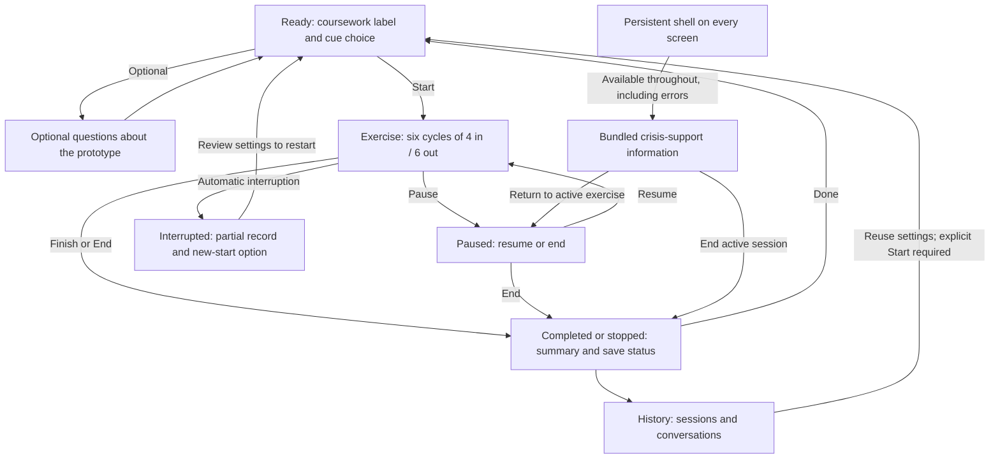

# Assignment 3 — Part 1: Design and planning

**Project:** Pause — a mental health skills coursework prototype  
**Milestone:** Part 1, design and planning  
**Date:** October 13, 2026

This report contains the proposed experience, flow diagram, UI sketches, model role, stored data, research reasoning, and selected design evidence. The planned stack is Vue, FastAPI, and SQLite on localhost. The application has not been implemented at this design milestone.

## Repository and submitted version

| Required item | Value |
| --- | --- |
| Repository | [Health-App](https://github.com/abn54/Health-App) |
| Submitted design commit | **Required before submission:** the design has not been committed or published to this repository. |
| Design and evidence | Included in this report. Hosted links to the supporting repository documents require those files to be published first. |

## Purpose and chosen skill

Pause will guide the assignment's 4–6 paced-breathing skill: inhale for four counts, exhale for six, and repeat six times. At one second per count, the intended exercise lasts 60 seconds. It will require no typed response or model request during pacing.

This skill offers a clear rhythm that the interface can carry with little reading or decision-making. Implementing one skill keeps the design coherent. Sensory grounding would add several prompts, while cognitive reframing would require written judgments. Those alternatives are deferred because of interaction effort and project scope; this choice does not establish clinical superiority.

The fictional walkthrough uses Alex, a student preparing for an imagined presentation. Evaluation will use fictional scenarios only. The interface will identify itself as coursework and state that it does not provide therapy, diagnosis, or human monitoring. It must not be offered as a tool to rely on during distress.

## Main experience



The normal route is Ready → Exercise → Summary, with History optional. The shell's **Crisis support** control remains available on every screen. Opening support during an exercise pauses it; returning requires a separate Resume action. If support is opened elsewhere, Return restores that prior screen. If an exercise becomes interrupted while support is open, Return shows the interrupted state instead of offering Resume.

Opening History while running also pauses first. A paused-session banner preserves Return to exercise and End. Reusing another session's settings is available after the active session ends. A conversation saved before Start remains a draft labeled Not started, with no exercise duration.

## UI sketches

These sketches illustrate the planned interface; they are not screenshots of an implemented app.

```text
READY
Pause · Coursework prototype           [Crisis support]
Fictional testing only. Not therapy. Nobody monitors this app.

4–6 paced breathing · 60 seconds
In for 4 counts. Out for 6. Repeat 6 times.

[Start exercise]
[Questions about this prototype]       [History]

Pacing cue: [Animated circle | Text only]
[ ] Remember this choice on this device
Local saving is attempted. Check the save status. [Data controls]
```

```text
EXERCISE
Pause · Coursework prototype           [Crisis support]

                      Inhale
                         3
               (expanding pacing circle)

                   Cycle 2 of 6
                    [Pause] [End]
Pacing cue: [Animated circle | Text only]
Changes here apply to this session only.
```

```text
SUMMARY / HISTORY
Pause · Coursework prototype           [Crisis support]

Session status: Completed / Stopped / Interrupted / Not started
Available timing · initial and last recorded cue
Save status: Saved / Not saved

[View conversation] [Use cue settings] [Delete saved session]
[Done]
```

The circle will expand during inhale and contract during exhale. The words and count will convey the same pace without motion. The default will honor the operating system's reduced-motion setting. A visible cue selector will allow switching modes before or during the exercise without resetting the phase, count, or fractional progress.

Controls will support keyboard use and visible focus. Screen-reader announcements will identify phase changes rather than every animation frame. Browser behavior, zoom, and assistive-technology pacing remain implementation checks. Speech is outside this design's scope.

## Duration, stopping, and failures

One cycle lasts `4 + 6 = 10` seconds; six cycles total `60` seconds. The timing measure begins with the first rendered exercise instruction and ends with the final planned step. There are no planned model waits, save waits, intermediate instruction pages, or required user responses inside that interval.

The controller will use one monotonic clock, `performance.now()`, for pacing and elapsed duration. Animation frames will render the schedule rather than advance a separate timer. Actual rendering and application delays must count toward the measured duration. Sixty seconds is a design calculation, not an observed result; a measured run exceeding 90 seconds would fail the assignment limit.

Entry/setup is estimated separately at 10–20 seconds for a reviewer who skips optional questions; this estimate is unmeasured. Optional conversation time depends on the user's choices. Start will remain available while an optional model request is running, and a late response cannot interrupt the exercise.

Pause will hold exact progress, including the fraction of the current count. Resume will continue that progress. End will exit immediately without confirmation, including from the support panel or History banner. The completion screen will remain open until the user chooses Done; no timer will force the user to finish, leave, or restart.

Explicit user pauses and time spent accessing support are excluded from the assignment measure without double subtraction. A hidden tab, reload, or browser suspension is an interruption, not an excludable voluntary pause. It will stop pacing and require a fresh Start from Ready. Interrupted or stopped runs will not be labeled completed.

A failed model request will produce fixed fallback copy while preserving Start, End, and support access. Database failures will show Not saved and allow explicit retry. Completing an exercise will not imply that its record was successfully saved.

## Model role and relevant context

The conversational model will interpret optional natural-language questions about the application. For example, “Do I have to watch the moving shape?” should select the approved explanation of text-only pacing; “What happens to what I type?” should select the storage explanation.

Its context will contain an approved catalog covering the skill description, controls, cue settings, storage, and prototype limits, plus the explicitly selected cue and at most four recent messages from the current session. A vector database is unnecessary for this small context. It will not retrieve unrelated past conversations by default.

The proposed response contract is a catalog selection:

```json
{"reply_id":"motion","evidence_ids":["catalog:motion"]}
```

FastAPI will validate the selected ID and matching catalog reference, then display approved text. Malformed output, unknown IDs, mismatched references, or provider failure will use a fixed fallback. Validation limits displayed content; it cannot prove that a valid selection was relevant to the question.

The model cannot change the prescribed skill, timer, preferences, saved records, or navigation. Vue will control pacing and exits, FastAPI will validate requests and persistence, and static client content will supply support access. This follows the course's contextual-chatbot pattern while keeping application behavior under explicit control.

## Stored data, history, and personalization

| Record | Proposed information | Purpose |
| --- | --- | --- |
| Profile/preferences | Generated local ID; explicitly remembered animated/text cue | Avoid repeating a selected presentation preference. |
| Session | Skill/content version, status, initial and final/last recorded cue, available timestamps and durations | Review what occurred and distinguish completed, stopped, interrupted, and never-started sessions. |
| Conversation | Submitted fictional question, displayed reply, response source, catalog/prompt version, model identifier when applicable | Review conversations and distinguish fixed, mocked, and live responses when implemented. |
| Session events | Starts, pauses/resumes, support/history access, cue changes, exits, and interruptions | Explain state and timing without recording every animation frame. |

SQLite will store these records locally. Missing measurements will remain unknown rather than being filled with estimates. A failed write may remain only in page memory and be lost on closing the page; the UI will explain that limitation. Deleting a session will also remove its conversation and events. Preference reset and deletion of all local data will require deliberate user action.

Remembering a cue will require an explicit choice. Ready will show it and allow an override. During-exercise changes will affect that session only. History will show the initial and final/last recorded cue and allow copying the latter into Ready for review; it will not automatically save a preference or start the exercise. Never-started drafts will have no cue-reuse action.

The application will know selected preferences, submitted fictional text, and interaction records. It will not know distress level, diagnosis, whether someone followed the pacing, or whether the skill helped. It will not infer treatment needs or alter duration based on wording, typing speed, or past completion.

| Decision | Benefit | Cost and user control |
| --- | --- | --- |
| One prominent Start action | Reduces reading and choice effort | Limits skill selection; the chosen skill is explicit before Start. |
| Optional questions | Allows explanation without mandatory typing | Less conversation is collected; users can bypass the panel. |
| Explicit remembered cue | Saves repeated setup | Adds a small setting; override/reset remain available. |
| Visible history and local saving | Supports review and reuse of chosen settings | Requires upfront notice, truthful save status, and deletion controls. |

## Independent crisis access and input policy

The shell will provide a clearly labeled **Crisis support** control throughout the experience, including loading, model failures, and database errors. It will open bundled, region-labeled support information without an API, model, or classifier decision. External destinations still depend on the device/network and external service. Location will not be inferred from conversation text.

A narrow, documented phrase rule may also display the panel for explicit crisis-related fictional input. Matching will run before a model call, with the same rule checked server-side for direct requests. A match will use fixed prototype-boundary copy and skip the model request. It will not send alerts, contact anyone automatically, or imply monitoring.

The rule is an interface cue, not a risk assessment. It can flag quotations or negations and miss paraphrases, misspellings, or other languages. A false match can be dismissed; an unmatched message cannot be labeled safe. Manual support access will always remain available. When an exercise is paused behind the support view, Return and immediate End will preserve user control.

## Research grounding and alternatives

The supplied assignment describes a study with 15 patients, 13 clinicians, 15 prototype evaluations, and 150 coded participant–task combinations. Mention counts and task references describe where findings appeared; they do not establish clinical effectiveness.

| Finding available in the supplied brief | Design choice and reasoning | Alternative and tradeoff |
| --- | --- | --- |
| R1: attention was lost beyond 90–100 seconds; the assignment sets a 90-second limit | Use a 60-second intended sequence with no model or save waits. | Ninety seconds leaves less margin for app delays. Actual timing still needs measurement after implementation. |
| D1 caveat: a simpler interface does not establish reliable distress detection | Use a consistently simple exercise view and explicit preferences. | Automatic adaptation might reduce effort but relies on uncertain inference and can remove control. |
| Personalization can save repeated choices but collection adds effort | Make cue memory optional and visible; permit overrides and reset. | Required onboarding asks for more decisions; hidden adaptation obscures why the interface changed. |
| Skill steps, saved state, exits, and crisis access require deliberate design | Assign them to application code and bundled content. | Chat-led pacing and prompt-only controls introduce variable timing and unreliable behavior. |
| Reading, typing, and decision effort matter | Require no written input during the exercise; keep explanation optional. | A conversation-first entry would offer more dialogue but delay the direct route to the skill. |

This mapping uses the supplied assignment narrative. Its full R1–R4 / D1–D6 table was not included, so no unavailable label definitions are invented. Checking this mapping against that table remains a research-source question for the design.

### Use of the supplied Kaggle resource

The [Kaggle conversation resource](https://www.kaggle.com/datasets/elvis23/mental-health-conversational-data) was inspected through its public preview and rechecked on October 13. It shows `intents.json` containing 80 intent entries; the sampled greeting uses `tag`, `patterns`, and `responses`. This structure informs the app's mapping of varied questions to approved answers:

| Proposed intent | Authored fictional input variations | Approved response topic |
| --- | --- | --- |
| `motion` | “Can I turn off the moving circle?” / “Is there a text-only option?” | Cue choice without changing exercise progress. |
| `storage` | “What gets saved?” / “Will my question stay after I close the page?” | Local saving, actual save status, and deletion. |
| `controls` | “Can I stop halfway?” / “What does Pause do?” | Immediate End and pause/resume behavior. |

These are design examples, not copied dataset records or executed model responses. The inspected greeting sample solicited personal context, reinforcing the choice to keep questions optional. The dataset was used as a design reference; its records were not downloaded, imported into the catalog, or used for training. Detailed provenance and the adaptation are documented in `docs/dataset-design-notes.md`.

## Documentation, reuse, and selected process evidence

`README.md` describes the milestone and how to review the documents. `AGENTS.md` records the prescribed sequence, model/application boundary, fictional-test restriction, persistence conventions, and evidence rules. Design and architecture notes are in `docs/`; `AI-USE.md` records the tools and their roles.

No earlier travel-app or hotel-chatbot code was supplied. The familiar frontend/API/SQLite and contextual-conversation patterns informed the design; no concrete code reuse is claimed.

| Design activity | Evidence and resulting decision |
| --- | --- |
| Revised entry approach | Considered asking for personal context and waiting for a model reply. Review of the brief's effort/timing requirements led to a directly available Start action and optional questions. This was a design revision, not a runtime failure. |
| Consistency review | Found ambiguous support-panel exit, cue switching, draft recovery, and save wording. Specified immediate End, uninterrupted cue changes, Not started draft labels, and save status that reflects the actual write result. |
| Document verification | Checked merged content, internal links, and code fences. These checks establish document consistency, not runtime behavior, measured duration, or clinical effectiveness. |

The curated evidence log records selected prompts, observations, changes, and decisions without credentials or personal health information. No application tests or recordings are claimed for this design milestone.

## Open design questions

1. Does the full instructor research table require changes to the relevant mapping or preference design?
2. Which target browser and phase-announcement behavior provide usable pacing with keyboard access, zoom, and reduced motion?
3. Which course-permitted model reliably selects the relevant catalog entry, and what browser scheduling gap should count as an interruption?

## AI-use disclosure

OpenAI Codex, identified in this session as a GPT-6-based agent, assisted with requirement extraction, design alternatives, flow/sketches, model/data planning, document review, and this report. The exact serving-model identifier was not exposed. Earlier review subagents used the inherited model to check dataset fit, requirement coverage, and design consistency.

Web browsing and the Codex in-app browser inspected the supplied dataset/resource pages. Local command/file tools and Python 3.14.7 supported Markdown editing and document checks. GitHub connector tools support publication of the student-authorized Part 1 design documents. No application model has been called or trained, and no real person in distress participated. The student should review the design and disclosure before submission.
